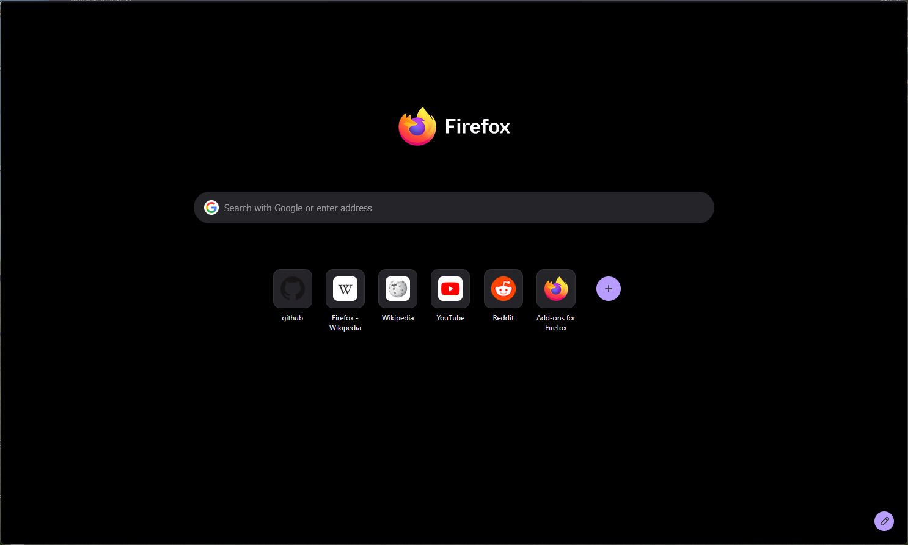
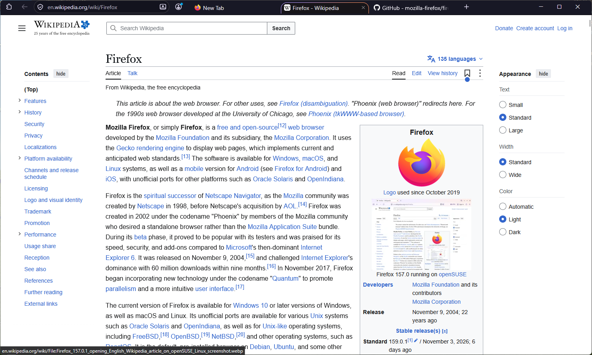
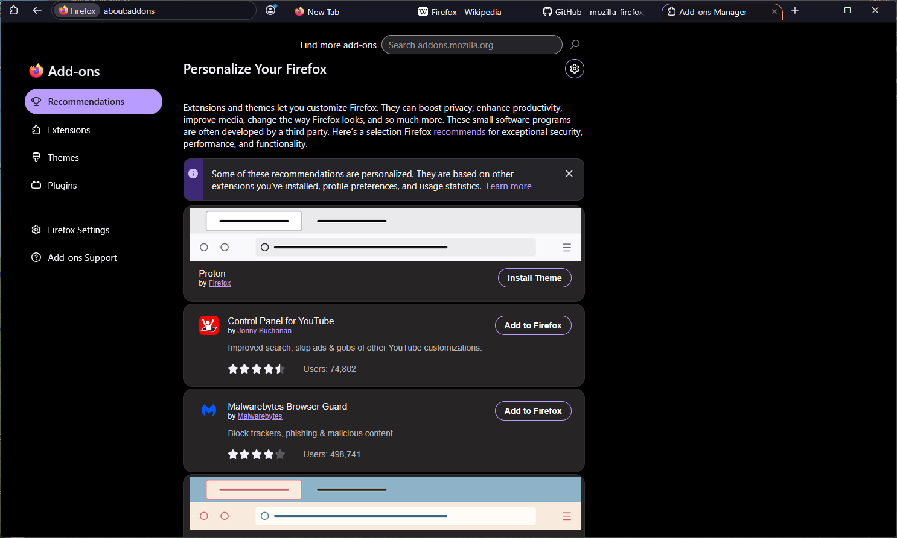
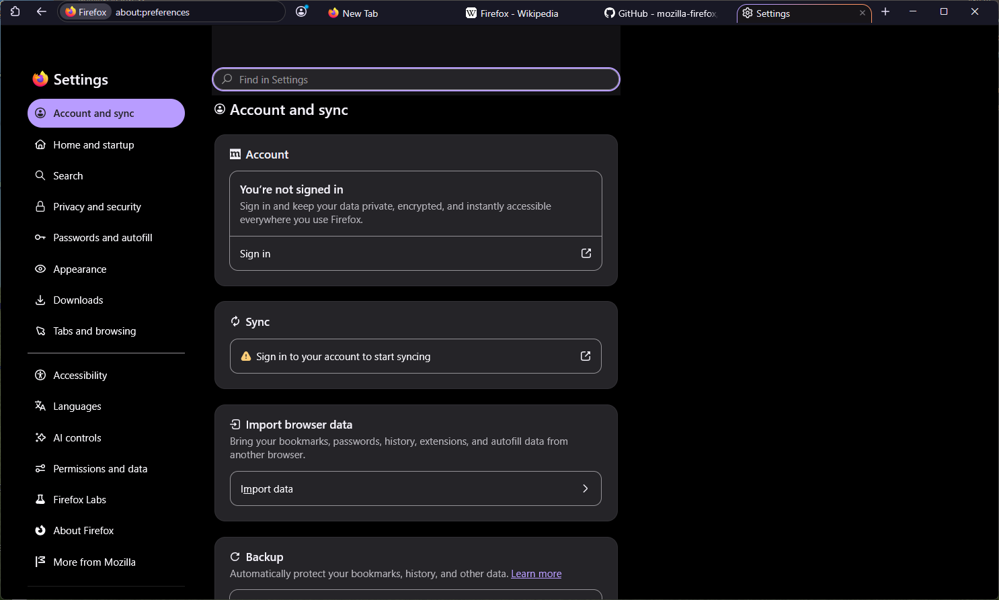

# NothingFirefoxCss

Theme `userChrome.css` / `userContent.css` tối giản cho Firefox: toolbar tự ẩn, layout **một dòng** (thanh địa chỉ + tab nằm chung một hàng), nền đen cho các trang nội bộ (New Tab, Settings, Add-ons).

> Dựa trên code của [Bali10050/FirefoxCSS](https://github.com/Bali10050/FirefoxCSS).

## Ảnh chụp

**Toolbar ẩn**: chỉ còn nội dung trang



**Toolbar hiện** (rê chuột lên mép trên cửa sổ, hoặc ghim bằng `Ctrl+Shift+B`): thanh địa chỉ bên trái, tab bên phải, tất cả trên một dòng



**about:addons**: gọn hơn, nền đen



**about:preferences**: nền đen



## Tính năng

- Ẩn tab bar, nav bar và bookmarks bar khi không dùng; **rê chuột lên mép trên cửa sổ** để hiện lại.
- **`Ctrl+Shift+B`** để ghim tab và thanh địa chỉ luôn hiển thị (bookmarks bar vẫn ẩn). Bấm lần nữa để quay về chế độ tự ẩn.
- Layout một dòng khi cửa sổ rộng ≥ 950px; hẹp hơn thì tự chuyển về hai dòng.
- Ẩn các nút ít dùng: menu ☰, forward, reload, star, reader mode, PiP, translate, all-tabs.
- Nút đóng tab chỉ hiện khi rê chuột.
- Nền đen cho New Tab, Home, Private Browsing, `about:preferences`, `about:addons`.

## Cài đặt

### Windows

1. Tải repo về (Code → Download ZIP) rồi giải nén.
2. Nhấp đúp **`install.bat`**.
3. Chọn profile (Enter = profile mặc định, `A` = tất cả profile).
4. Nếu Firefox đang mở, script sẽ hỏi có muốn đóng không. Chọn `Y` thì Firefox được đóng và mở lại sau khi cài.

Có thể chạy trong `cmd` với tham số:

```bat
install.bat                          :: chọn profile
install.bat --all                    :: cài cho tất cả profile
install.bat "C:\path\to\profile"     :: cài vào một profile cụ thể
install.bat --uninstall              :: gỡ theme
install.bat --uninstall --all
```

### Linux (và macOS)

```bash
git clone <repo-url> NothingFirefoxCss
cd NothingFirefoxCss
chmod +x install.sh
./install.sh            # chọn profile
./install.sh --all      # cài cho tất cả profile
./install.sh ~/.mozilla/firefox/xxxx.default-release
./install.sh --uninstall
```

Script tự tìm profile ở các vị trí sau:

| Kiểu cài Firefox | Thư mục |
|---|---|
| deb / rpm / tarball | `~/.mozilla/firefox` |
| XDG (Firefox mới) | `~/.config/mozilla/firefox` |
| Snap | `~/snap/firefox/common/.mozilla/firefox` |
| Flatpak | `~/.var/app/org.mozilla.firefox/.mozilla/firefox` |
| macOS | `~/Library/Application Support/Firefox` |

### Script làm gì?

1. Nếu profile đã có `chrome/userChrome.css` thì backup cả thư mục `chrome` thành `chrome.backup-<ngày-giờ>`.
2. Copy `userChrome.css` và `userContent.css` vào `<profile>/chrome/`.
3. Ghi vào `<profile>/user.js` (dòng cũ của cùng pref sẽ được thay, không bị trùng):
   ```js
   user_pref("toolkit.legacyUserProfileCustomizations.stylesheets", true); // bật userChrome.css
   user_pref("browser.toolbars.bookmarks.visibility", "always");          // bookmarks bar hiện khi hover
   ```

### Cài thủ công

1. Mở `about:support` → **Profile Folder** → **Open Folder**.
2. Tạo thư mục `chrome` trong đó, copy `userChrome.css` và `userContent.css` vào.
3. Mở `about:config`, đặt `toolkit.legacyUserProfileCustomizations.stylesheets` = `true`.
4. Khởi động lại Firefox.

## Gỡ cài đặt

Chạy `install.bat --uninstall` (Windows) hoặc `./install.sh --uninstall` (Linux). Lệnh này xoá hai file CSS khỏi `chrome/`. Muốn khôi phục theme cũ thì copy nội dung từ `chrome.backup-*` vào lại `chrome`.

## Tuỳ chỉnh

Sửa `userChrome.css` (bản trong repo rồi chạy lại script, hoặc sửa trực tiếp trong `<profile>/chrome/`) rồi khởi động lại Firefox:

| Biến / selector | Ý nghĩa | Mặc định |
|---|---|---|
| `--NavbarWidth` | Độ rộng thanh địa chỉ (% chiều ngang) | `36` |
| `--TabsHeight` | Chiều cao tab | `25` |
| `--tab-border-radius` | Bo góc tab | `15px` |
| `#navigator-toolbox { background }` | Màu nền toolbar | `#181825` |

Muốn hiện lại một nút bị ẩn (vd. reload): xoá hoặc comment selector tương ứng (`#reload-button`) trong khối `display: none`.

## Xử lý sự cố

- **Theme không có tác dụng**: kiểm tra `about:config` → `toolkit.legacyUserProfileCustomizations.stylesheets` phải là `true`, và đúng profile đang dùng (xem `about:profiles`).
- **Cài nhầm profile**: chạy lại script và chọn profile có đánh dấu `(default)`, hoặc dùng `--all`.
- **Toolbar không hiện khi hover**: rê chuột sát mép trên cùng của cửa sổ, hoặc bấm `Ctrl+Shift+B` để ghim.
- **Firefox Snap/Flatpak**: profile nằm trong sandbox, script đã hỗ trợ sẵn. Nếu không tìm thấy, truyền đường dẫn profile trực tiếp.
